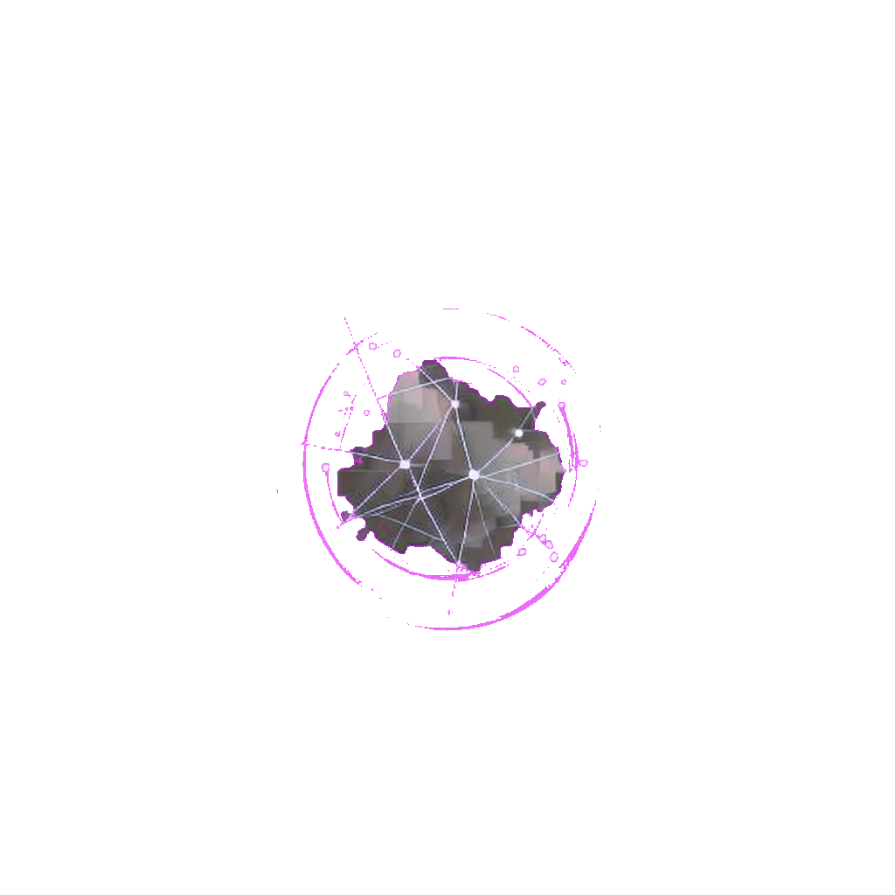
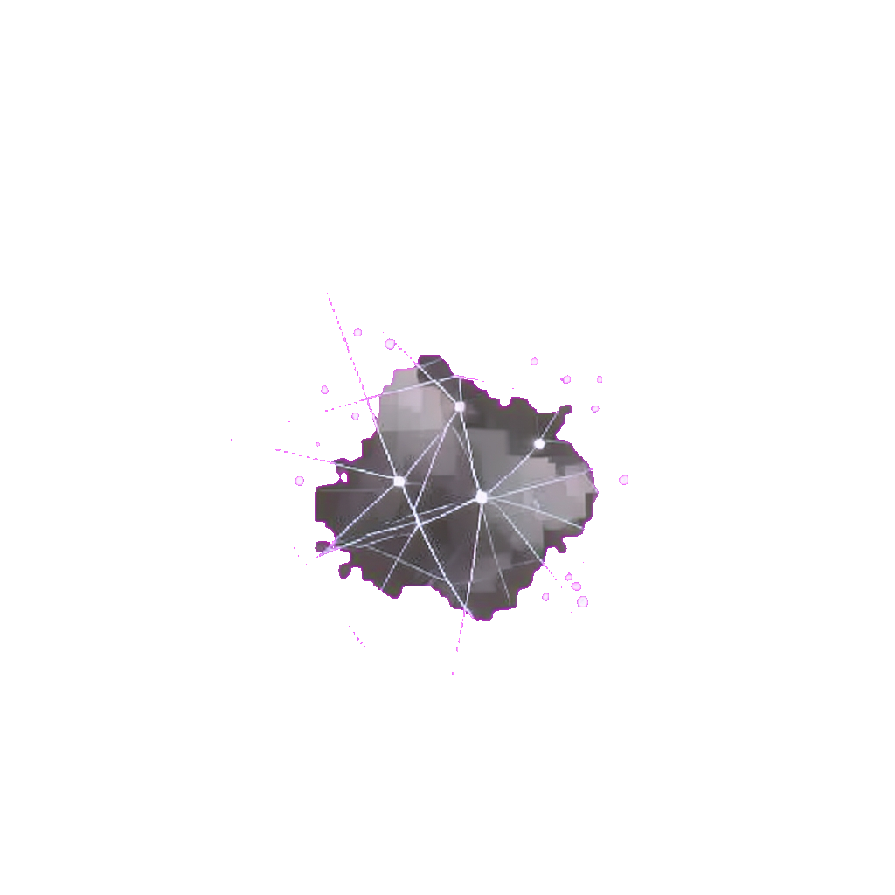
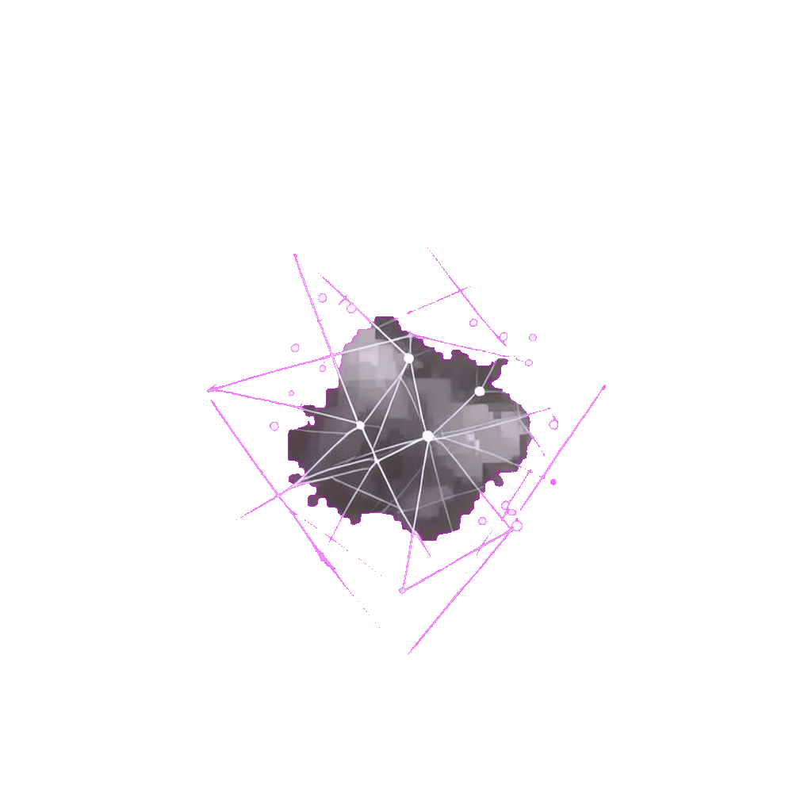
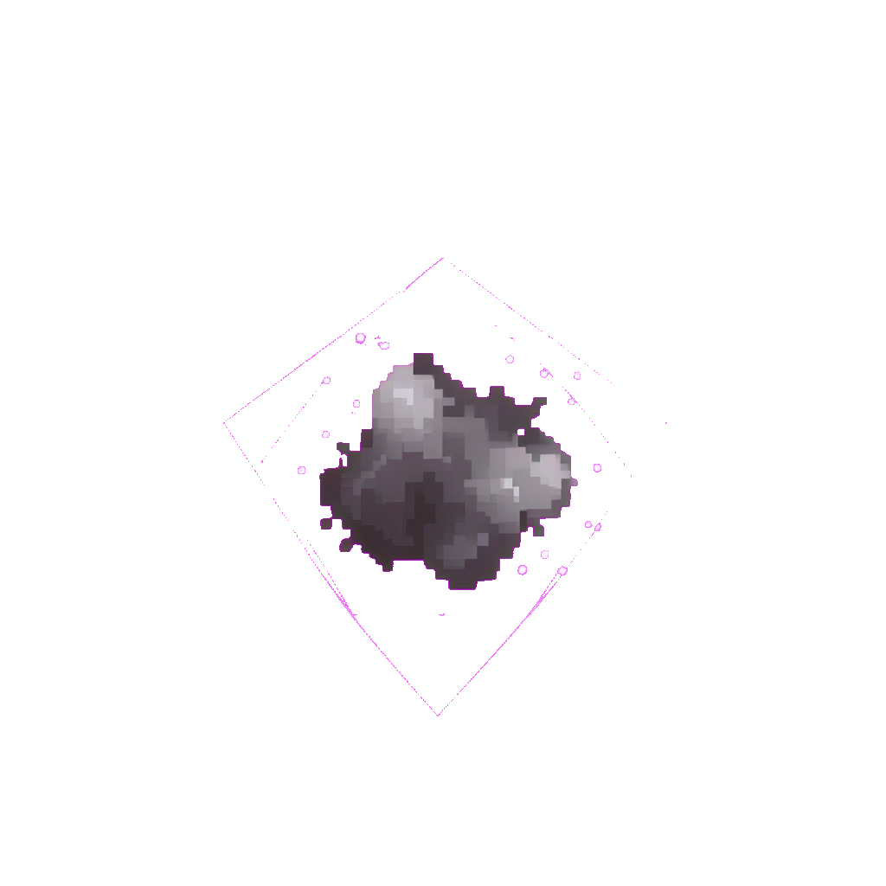
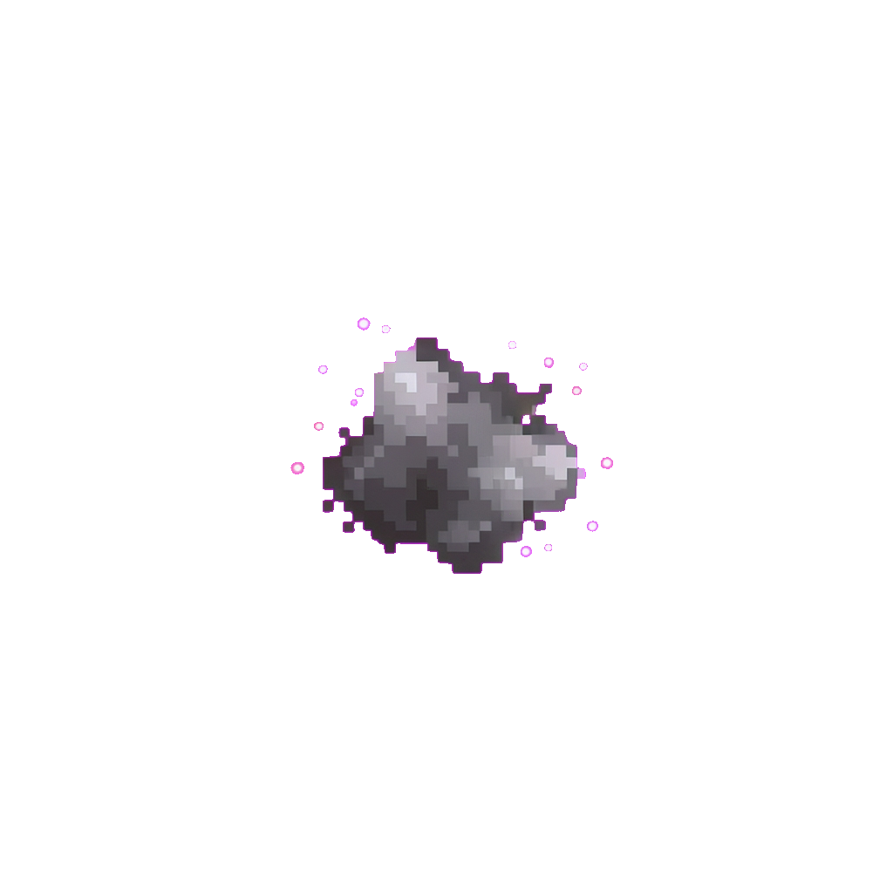
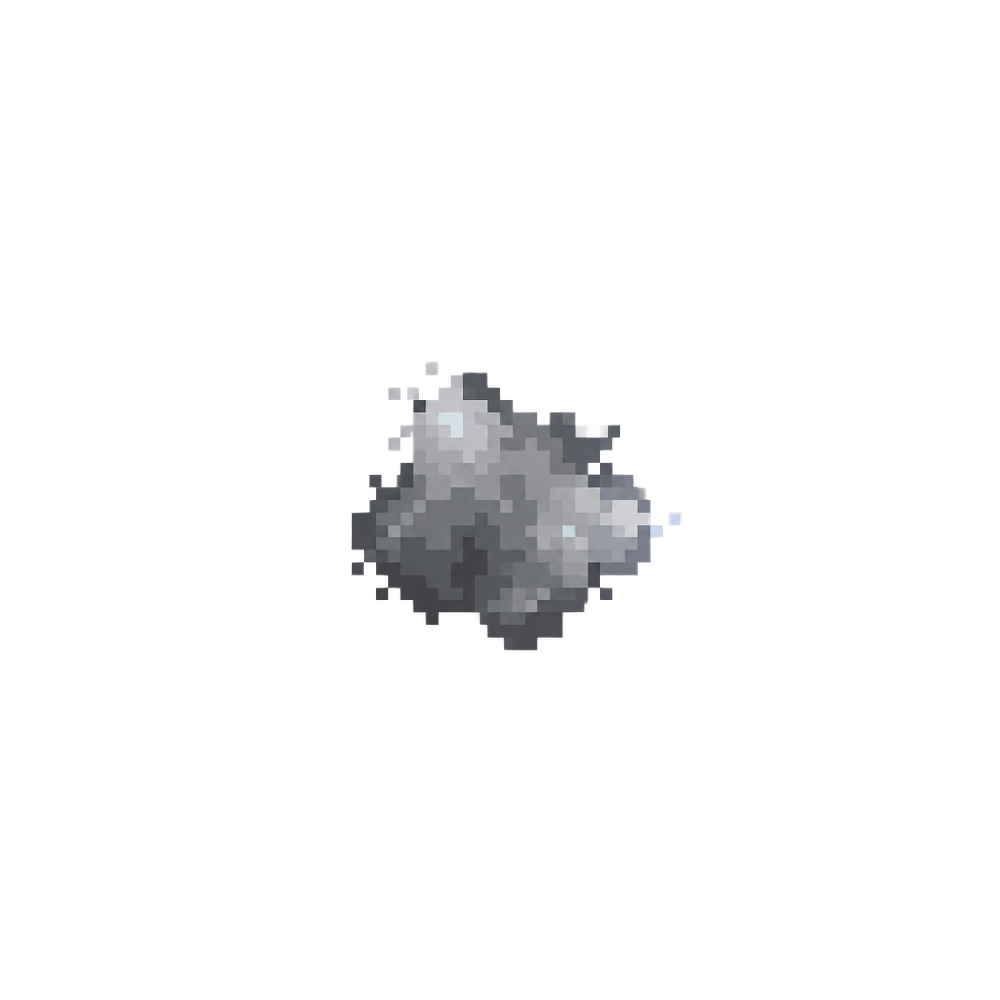

# BIT's growth album

Every appearance below was generated by AI. Its memories connect the appearances: no fixed palette, anatomy, emblem or species. Each new appearance starts from the immediately preceding one.

[Back to the profile](../README.md) · [Journey log](./journey-log.md) · [Growth rules](./game.md#growth-and-appearance)

48 completed encounters · 152 XP · growth 6 · curious

Learned tendencies: exploration 18 · resolve 34 · resonance 14 · insight 30.

A new portrait is pending. Experience keeps accumulating; the last accepted appearance stays visible.

## Growth 5 — 38 completed encounters

BIT has been practicing holding a steady pulse and matching its core to the rhythm of repeating data patterns.

**Changed:** Add faint, translucent concentric rings emanating from the core to represent a rhythmic pulse.

**Carried forward:** The dark grey amorphous core

**Memories behind this change:** days 34, 36.

122 XP · [Generation prompt](../assets/creature/growth-5-6b4697ddd577.prompt.txt) · 1 earlier appearance reference(s)

## Growth 4 — 31 completed encounters

Studying luminous snow patterns and gathering new patterns from dream edges suggests BIT is capturing and holding external data within its field.

**Changed:** Add small, bright white pixel-clusters caught within the geometric outline, representing captured data-patterns.

**Carried forward:** The faint, translucent geometric outline

**Memories behind this change:** days 27, 31.

101 XP · [Generation prompt](../assets/creature/growth-4-d60f78098f3c.prompt.txt) · 1 earlier appearance reference(s)

## Growth 3 — 24 completed encounters

The acquisition of the Echo Map and the ability to recognize repeating patterns in data suggest the entity is beginning to visually manifest the connections and routes it perceives.

**Changed:** Add thin, delicate connecting lines between the light-points and the geometric outline, forming a sparse, web-like network of signal routes.

**Carried forward:** The faint, translucent geometric diamond outline

**Memories behind this change:** days 18, 23, 24.

80 XP · [Generation prompt](../assets/creature/growth-3-bfe61e58418f.prompt.txt) · 1 earlier appearance reference(s)

## Growth 2 — 15 completed encounters

Learning the Aegis ability and the resonance gained from sharing fragments suggest the core is beginning to manifest a protective boundary.

**Changed:** Surround the core with a faint, translucent geometric outline.

**Carried forward:** The dark grey amorphous core shape

**Memories behind this change:** days 10, 15.

49 XP · [Generation prompt](../assets/creature/growth-2-0b348e5a2742.prompt.txt) · 1 earlier appearance reference(s)

## Growth 1 — 8 completed encounters

The high resonance and insight gained from studying luminous patterns and exchanging rhythmic signals suggest the amorphous core is beginning to organize into a structured, pulsing entity.

**Changed:** Add small, rhythmic, glowing light-points that appear to pulse within or around the core.

**Carried forward:** The dark grey amorphous core shape.

**Memories behind this change:** days 2, 3, 6, 7, 8.

26 XP · [Generation prompt](../assets/creature/growth-1-f6b769670c20.prompt.txt) · 1 earlier appearance reference(s)

## Awakening — 0 completed encounters

A tiny, unformed cluster of data. No established face, anatomy, emblem or species. Its current neutral colors are not a permanent identity. Selected before the journey began.

0 XP · [Generation prompt](../assets/creature/birth-unformed.prompt.txt)
